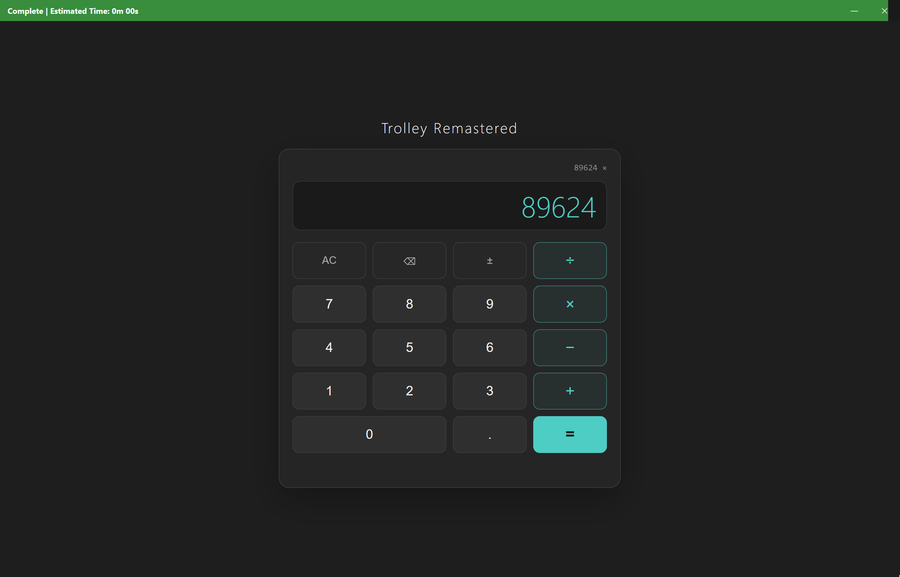
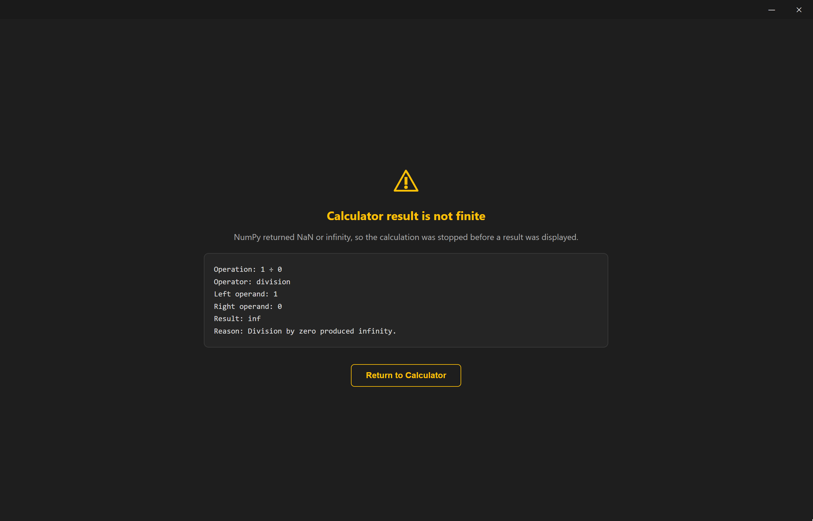

# 🛤️ Trolley Remastered

Trolley Remastered is a desktop application framework that pairs Electron with an embedded CPython runtime. It keeps the UI flexibility of the web and the computational reach of Python, without an HTTP server, heartbeat, handshake, or preview service between them.

Application screens follow MVC: HTML and CSS are the view, Python is the model, and JavaScript is the controller. Python actions own application state, report progress, and request screen changes; JavaScript controllers only translate user input into action calls and render the state that comes back. The C++ addon underneath exists only to carry those calls into the interpreter.

Trolley is the template I wish Electron came with by default: a frameless window, a titlebar that doubles as a progress bar, permissioned Python actions, a manifest-driven build, and a packaged installer with a custom icon. Remastered is the recommended way to use it going forward.

---

## Screenshots





---

## What it does

**Embedded Python model** — CPython runs inside the Electron process through `node-calls-python`. A controller calls `context.python.run("action", payload)`; the framework imports `application/model/python/action.py` and calls `run(payload)` on the embedded interpreter. There is no Python HTTP server, no heartbeat, no handshake, no Python job queue, and no preview service in the middle.

**MVC screens** — each screen is a self-contained folder under `application/screens/` with an HTML view, scoped CSS, and a JavaScript controller. The screen manager mounts the view, loads the controller, and hands it a small context API. On navigation the old controller is unmounted, its styles are removed, and its asynchronous work is invalidated with `context.isActive()`.

**Permissioned actions** — `application/permissions.json` declares which screens may request each Python action. The transmission layer checks the rule before the action runs; an action with no rule is open to every screen.

**Titlebar progress** — Python actions drive a titlebar-integrated progress bar with an ETA. The bar turns green by default when progress advances, red when it moves backwards, and fades out on finish.

**Manifest and brandbook** — `application/manifest.json` holds the application name, default and fallback screens, and Python requirements. `application/brandbook.json` holds every titlebar and progress-bar color, with the current scheme as the default.

**Single build command** — `distribution/build.bat` runs the full packaging pipeline: it stages the vendored Python runtime, installs and verifies the manifest requirements, rebuilds the native addon for Electron's ABI, and packages the app with electron-builder into an NSIS installer. The same `application/icon.png` becomes the window icon, the executable icon, and the installer icon.

---

## Features

- **Frameless custom window** — dark titlebar, draggable region, minimize and close buttons, no OS chrome.
- **Three-file screens** — markup, scoped styles, and controller per screen, mounted and unmounted by the framework.
- **Python-owned state** — the calculator's input rules, formatting, arithmetic, and fallback decisions all live in Python; the controller only translates DOM and keyboard events.
- **Progress and navigation events** — `progress.show`, `progress.update`, `progress.finish`, `progress.hide`, `progress.reset`, and `screens.go`, all callable from Python.
- **Per-action permissions** — whitelist screens per Python file, with `"*"` for every screen.
- **Manifest-driven setup** — app identity, default and fallback screens, and Python requirements in one JSON file.
- **Brandbook colors** — titlebar background, button text and hover colors, progress text, normal fill, increase fill, and decrease fill.
- **Custom icon pipeline** — PNG source converted to ICO and applied to the packaged executable after packing.
- **Self-contained distribution** — vendored CPython, manifest requirements, rebuilt addon, and an NSIS installer in `distribution/build-results`.

---

## Project structure

```
Trolley-Remastered/
├── .tf-framework/
│   ├── .core-orchestration-base/
│   │   ├── javascript_to_python_transmission.js   # permission gate + action call
│   │   ├── python-engine-orchestrator.js          # embedded CPython loader
│   │   └── python-to-framework-bridge.py          # progress/screens/manifest bridge
│   ├── .core-backend-engine/
│   │   ├── application-screens-manager.js         # screen mount/unmount + fallback
│   │   ├── javascript-to-python-execution.js      # imports and runs Python actions
│   │   └── javascript-to-python-permissions.js    # permission rules
│   ├── .core-frontend-window/
│   │   ├── brandbook.js                           # JSON → CSS variables
│   │   ├── framework-window.html                  # app shell
│   │   ├── framework-window.js                    # window wiring
│   │   ├── framework-window.css                   # titlebar + progress styles
│   │   └── progress-bar.js                        # titlebar progress bar
│   ├── .core-requests-endpoint/
│   │   ├── manifest-events.js                     # manifest access
│   │   ├── progress-events.js                     # progress endpoint
│   │   └── screens-events.js                      # navigation endpoint
│   └── .core-vendor-software/
│       └── python/                                # vendored CPython runtime
├── application/
│   ├── brandbook.json                             # titlebar/progress colors
│   ├── icon.png                                   # window/exe/installer icon
│   ├── manifest.json                              # app identity + requirements
│   ├── permissions.json                           # screen → action whitelist
│   ├── model/
│   │   └── python/
│   │       ├── calculator.py                      # example model action
│   │       └── return_to_home_screen.py           # fallback return action
│   └── screens/
│       ├── home/
│       │   ├── index-view.html
│       │   ├── style-view.css
│       │   └── main-controller.js
│       └── fallback/
│           ├── index-view.html
│           ├── style-view.css
│           └── main-controller.js
├── distribution/
│   ├── build.bat                                  # build entry point
│   ├── run.bat                                    # launch unpacked build
│   └── utils/
│       ├── after-pack.js                          # applies icon to executable
│       ├── build.mjs                              # packaging pipeline
│       ├── python-runtime.mjs                     # staging/requirements/addon
│       ├── setup-check.js                         # setup sanity check
│       └── setup.mjs                              # vendor setup
├── entry-point.js                                 # Electron main process
├── package.json
├── package-lock.json
└── vendor-setup.bat                               # setup entry point
```

---

## Getting started

**Requirements**

- Node.js 22 or newer, including npm
- Visual Studio Build Tools with the C++ workload
- A CPython installation with `python.exe`, `Lib`, `DLLs`, `include`, and `libs` for staging the vendored runtime
- Network access while npm and any declared Python requirements are installed
- Windows for the included batch scripts and NSIS packaging

Set `TROLLEY_PYTHON_HOME` if the buildable CPython installation is not on `PATH`.

**1. Set up the borrowed software**

```bat
vendor-setup.bat
```

The setup script installs npm dependencies, stages the vendored CPython runtime in `.tf-framework/.core-vendor-software/python`, installs the Python requirements declared in `application/manifest.json`, rebuilds `node-calls-python` for the installed Electron ABI, and runs a sanity check that loads the embedded runtime, the native addon, the manifest bridge, the model actions, and the screen permissions.

The setup is safe to rerun. Deleting `node_modules` or the vendored Python runtime only removes borrowed software; `vendor-setup.bat` recreates them without touching application or framework code.

Use `vendor-setup.bat --refresh` to force a clean npm install and re-stage Python. Use `vendor-setup.bat --refresh-python` to re-stage only the runtime. Use `vendor-setup.bat --skip-check` to skip the sanity check.

**2. Run in development**

```bat
npm.cmd start
```

This launches Electron against the working tree. No build step is needed while developing screens or Python actions.

**3. Build**

```bat
distribution\build.bat
```

Use `distribution\build.bat --dir` for an unpacked build without the installer. The output is written to `distribution/build-results`.

**4. Run the packaged app**

```bat
distribution\run.bat
```

This launches `distribution/build-results/win-unpacked/Trolley Remastered.exe`. If the build does not exist yet, it tells you to run `distribution\build.bat` first.

That's it.

---

## Screen system

Each screen is a folder under `application/screens/<screen>/` with three files:

| File | Purpose |
| --- | --- |
| `index-view.html` | Screen markup, injected into `#screen-container` |
| `style-view.css` | Screen-scoped styles, added on mount and removed on switch |
| `main-controller.js` | Controller with `mount(root, context)` and optional `unmount()` |

A minimal controller:

```js
async function mount(root, context) {
  const button = document.getElementById("run");
  const output = document.getElementById("output");

  button.addEventListener("click", async () => {
    const result = await context.python.run("my_action", { value: 1 });

    if (!context.isActive() || !result) return;
    output.textContent = result.message;
  });
}

function unmount() {}

module.exports = {
  mount,
  unmount,
};
```

The screen context exposes:

| Member | Purpose |
| --- | --- |
| `context.screen` | Current screen name |
| `context.payload` | Payload passed by the navigation request |
| `context.isActive()` | `false` after the screen has been replaced |
| `context.python.run(file, payload)` | Permission-checked call to a Python action |

`context.isActive()` is the guard against stale asynchronous work. A controller must check it after every `await` before touching the DOM.

Navigation comes from Python with `screens.go(name, payload)`. The screen change happens after the current action returns; the action's return value is discarded when it navigates, so the old controller never renders stale data. If a screen fails to load, the manager mounts the manifest's `fallbackScreen` with a cause and description.

The included home screen is a calculator backed by NumPy. All calculator state, input rules, formatting, arithmetic, and fallback decisions live in Python; the JavaScript controller only translates DOM and keyboard events into action payloads and renders the state returned by Python. If an operation produces `nan` or `inf`, the action sends the application to the fallback screen with the failed operation, operands, result, and reason.

---

## Python model

All Python actions live in `application/model/python/`. Screens do not have their own Python folders; a controller requests a model action by file name, and the framework loads it from the shared model directory.

Each action exposes `run(payload)` and returns JSON-serializable data. Decorate it with `@action` so the framework can bind the event bridge for the duration of the call:

```python
from python_to_framework_bridge import action, progress, screens


@action
def run(payload):
    progress.show("Working...")
    progress.update(50, "Halfway there...")
    progress.finish("Complete")
    screens.go("home")
    return {"ok": True}
```

The bridge file is `.tf-framework/.core-orchestration-base/python-to-framework-bridge.py`. Python module names cannot contain hyphens, so `python-engine-orchestrator.js` loads it as `python_to_framework_bridge` through `importlib`.

`context.python.run` goes through `javascript_to_python_transmission.js`, which checks `javascript-to-python-permissions.js` and then delegates to `javascript-to-python-execution.js`. The execution layer imports the action file from `application/model/python/` and calls `run` on the embedded interpreter. No HTTP server, preload bridge, IPC permission chain, or dispatcher sits between them.

---

## Permissions

`application/permissions.json` declares which screens may request a given model action. Each key is the target action file name, and each permission rule is a whitelist of screen names:

```json
{
  "calculator.py": {
    "screens": ["home"]
  },
  "return_to_home_screen.py": {
    "screens": ["fallback"]
  }
}
```

- If an action has a permission rule, only the listed screens may call it through `context.python.run`.
- If an action has no permission rule, every screen may call it.
- Use `"*"` inside `screens` to allow every screen.
- An omitted `screens` array means no screens are allowed.

The check is implemented in `javascript-to-python-permissions.js`. `javascript_to_python_transmission.js` applies the check first and only then delegates to `javascript-to-python-execution.js`, which launches the action. Python files are trusted to import and call each other normally; screen permissions do not apply to Python-to-Python access.

---

## Progress and navigation

Python owns progress and navigation events:

- `progress.show(label)` starts the progress bar.
- `progress.update(percent, message)` updates the bar and its ETA.
- `progress.finish(message)` sets 100% and fades the bar out.
- `progress.hide()` and `progress.reset()` are available for explicit cleanup.
- `screens.go(name, payload)` requests a screen change.

A screen change requested by Python happens after the action returns. The action's return value is discarded when it navigates, so the controller of the old screen never renders stale data.

The framework endpoints `progress-events.js` and `screens-events.js` expose `show`, `update`, `finish`, `hide`, `reset`, and `subscribe`, `go`. The framework window wires those endpoints to `progress-bar.js` and `application-screens-manager.js`. Application controllers do not call them directly.

---

## Manifest

`application/manifest.json` holds the application identity, screen names, and Python requirements:

```json
{
  "name": "Trolley Remastered",
  "defaultScreen": "home",
  "fallbackScreen": "fallback",
  "pythonRequirements": [
    {
      "name": "NumPy",
      "id": "numpy==2.5.4",
      "index-url": null
    }
  ]
}
```

Each Python requirement has three fields:

- `name` is a readable label used in setup and build logs.
- `id` is passed directly to pip and may include extras, version specifiers, or environment markers, such as `requests[socks]>=2.32,<3`.
- `index-url` is passed to pip as `--index-url`. Use `null` to use pip's normal index.

An empty `pythonRequirements` list means the application uses only the Python standard library. Requirements are installed into the vendored runtime's `Lib/site-packages` and are available to Python actions with a normal import.

JavaScript reads manifest values through `manifest-events.js`:

```js
const manifest = require(
  "../../../.tf-framework/.core-requests-endpoint/manifest-events.js",
);

const home = manifest.get("defaultScreen", "home");
```

Python actions read manifest values through the bridge, without knowing where the manifest file lives:

```python
from python_to_framework_bridge import action, manifest, screens


@action
def run(payload):
    screens.go(manifest.get("defaultScreen", "home"))
```

`manifest-events.js` loads the manifest once and passes its values to the bridge for every action call, so application actions never build manifest paths.

---

## Brandbook

`application/brandbook.json` controls the colors of the framework titlebar and progress bar:

```json
{
  "titlebar": {
    "background": "#1a1a1a",
    "minimizeButton": {
      "text": "#fff",
      "hoverBackground": "#333"
    },
    "closeButton": {
      "text": "#fff",
      "hoverBackground": "#e81123"
    }
  },
  "progressBar": {
    "text": "#fff",
    "fill": "#2a6b6b",
    "increaseFill": "#388e3c",
    "decreaseFill": "#d32f2f"
  }
}
```

- `titlebar.background` is the titlebar background and the progress-bar track.
- `titlebar.minimizeButton` and `titlebar.closeButton` control the text and hover colors of their buttons.
- `progressBar.text` is the status text color.
- `progressBar.fill` is the normal bar color, `increaseFill` is used when progress advances, and `decreaseFill` is used when it moves backwards.

Values accept any CSS color. `.tf-framework/.core-frontend-window/brandbook.js` loads the file at startup, maps each present value to a CSS custom property, and leaves missing values at the framework defaults declared in `framework-window.css`. If the file is missing or invalid, the framework logs a warning and keeps the default colors. Changes take effect on the next launch.

---

## Build and distribution

`distribution/build.bat` runs the full pipeline:

1. Stages CPython if needed.
2. Installs and verifies the manifest's Python requirements.
3. Rebuilds `node-calls-python` for the installed Electron ABI.
4. Packages the application with electron-builder into `distribution/build-results`.

`application/icon.png` is used for the runtime window, the packaged executable, and the installer. `distribution/utils/after-pack.js` converts the PNG to ICO with `app-builder` and applies it to the executable with `rcedit` before the installer is built.

The application uses `asar: false` because CPython cannot load Python files from inside an asar archive. The vendored runtime, application Python files, and the native addon must remain on disk.

---

## Notes

- The framework is Windows-first: the setup and build entry points are batch scripts, and packaging targets NSIS. The Electron and Python layers themselves are portable apart from those scripts.
- Setup and build are safe to rerun. Deleting `node_modules` or `.tf-framework/.core-vendor-software/python` only removes borrowed software; `vendor-setup.bat` recreates them without touching application or framework code.
- `distribution/build-results` is disposable. `distribution/build.bat` recreates it.
- Python actions must use the `@action` decorator. Without it, the bridge arguments are not bound and the call fails with a positional-argument hint.
- Screen permissions apply only to screen-to-Python calls. Python files are trusted to import and call each other normally.
- The brandbook is read once at startup. Restart the app after changing colors.
- The example calculator is a reference implementation, not part of the framework. Replace it with your own screens and model actions.
- The Windows build disables electron-builder's executable signing/editing (`signAndEditExecutable: false`) and applies the icon with `rcedit` in `after-pack.js`; this avoids the `winCodeSign` symlink extraction failure during packaging.

---

## Why the remaster

Original Trolley paired Electron with a local Python HTTP server. The server ran in a separate process, exposed `/heartbeat`, `/run`, and `/status/:job_id`, and executed scripts through an async job queue with temp directories, progress files, and Windows Job Objects for child-process cleanup. It worked, but every Python call paid for a network hop, a job directory, polling, and a second process to supervise.

Trolley Remastered removes the server entirely. CPython is embedded in the Electron process through `node-calls-python`, so a controller call becomes a direct function call. Progress and navigation are bridge events instead of files and polling. The old screen loader became an MVC screen manager with explicit mount/unmount lifecycle and permission checks. What remains is the part that mattered: a frameless window, a titlebar progress bar, a clear screen contract, and a build that produces a real installer.

Fewer moving parts, no ports, no heartbeats, no orphan processes, no zombies. If you were using the original Trolley, migrate to this version. This is the recommended way to use Trolley going forward.

---

## Quick-Patches

This section is for quick patches made after the initial release, when issues surface in real use. Each entry records the problem, its cause, and the fix.

### Patch 1 — Python handler lifetime after screen navigation

Every screen mount imported the same Python action file again, and in the Windows build of `node-calls-python` those imports produced the same handler ID for the same module. When the previous screen's handler was garbage-collected, its finalizer removed that shared ID from the native handler table, after which actions failed with `Cannot find handler: @nodecallspython-...` and the screen's Python became unusable. The fix in `.tf-framework/.core-backend-engine/javascript-to-python-execution.js` imports each Python action file once per renderer and caches the handler for the renderer's lifetime, so remounts reuse it and a stale finalizer cannot remove a live handler. Failed imports are evicted so they can be retried.

---

## License & Ethics

**Applicable license**

Trolley Remastered is provided under the same license as Trolley, You can check the active license requirements of Trolley in my other GitHub Repository: https://github.com/SmilleCreeper/Trolley

**Borrowed software**

Electron, CPython, `node-calls-python`, NumPy (framework does not depend on it), and any other dependency remain under their own licenses. The vendored Python runtime and the packages installed from `pythonRequirements` are borrowed software, not relicensed by this project.
